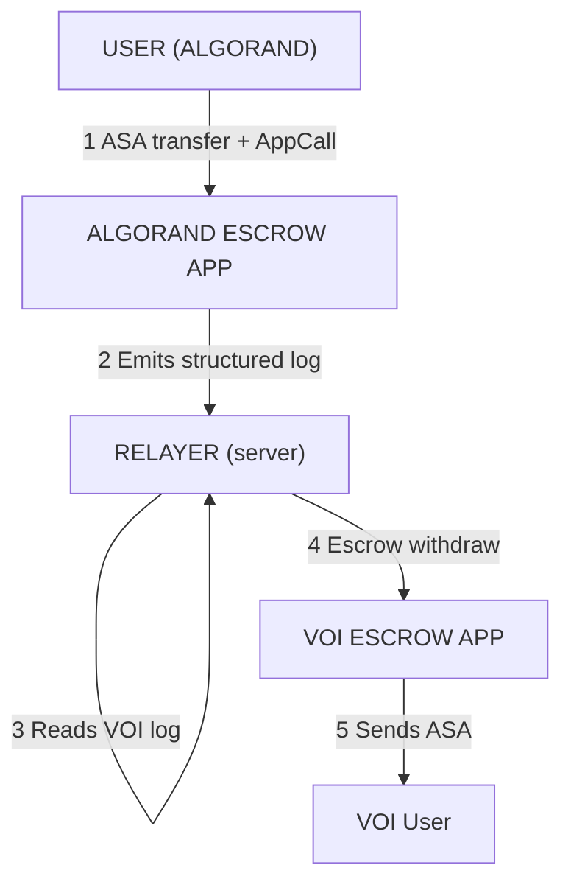

# ALGO-VOI
Algorand to VOI Mainnet Bridge

Coming

## AlgoVoi AVM evidence & interoperability suite

This repository is one of a set of AlgoVoi projects for Algorand and Voi settlement evidence and cross-chain interoperability. A bridge or relayer executes a transfer; [avm-proofpack](https://github.com/chopmob-cloud/avm-proofpack) makes the underlying chain facts independently verifiable offline; and [avm-algovoi-falcon](https://github.com/chopmob-cloud/avm-algovoi-falcon) supplies post-quantum signing for keys, accounts and attestations. The row for **this repository** is shown in **bold**.

| Repository | Role |
|---|---|
| [avm-proofpack](https://github.com/chopmob-cloud/avm-proofpack) | Portable, offline-verifiable Algorand/Voi transaction evidence anchored in State Proofs — the shared evidence core. |
| [avm-algovoi-falcon](https://github.com/chopmob-cloud/avm-algovoi-falcon) | Falcon-1024 (FIPS 206) post-quantum keys, Algorand `falcon_verify` LogicSig accounts and offline attestations — the identity layer. |
| [avm-voi-algo-bridge](https://github.com/chopmob-cloud/avm-voi-algo-bridge) | VOI → Algorand mainnet bridge: on-chain log validator, escrow and relayer. |
| **[avm-algo-voi-bridge](https://github.com/chopmob-cloud/avm-algo-voi-bridge)** | Algorand → VOI mainnet bridge (reverse direction). |
| [avm-wormhole-ntt-relayer](https://github.com/chopmob-cloud/avm-wormhole-ntt-relayer) | Wormhole NTT relayer bridging tokens between Algorand and Base. |
| [avm-hbar-bridge-relayer](https://github.com/chopmob-cloud/avm-hbar-bridge-relayer) | Treasury-model bridge relayer between Algorand and Hedera (HBAR/HTS). |
